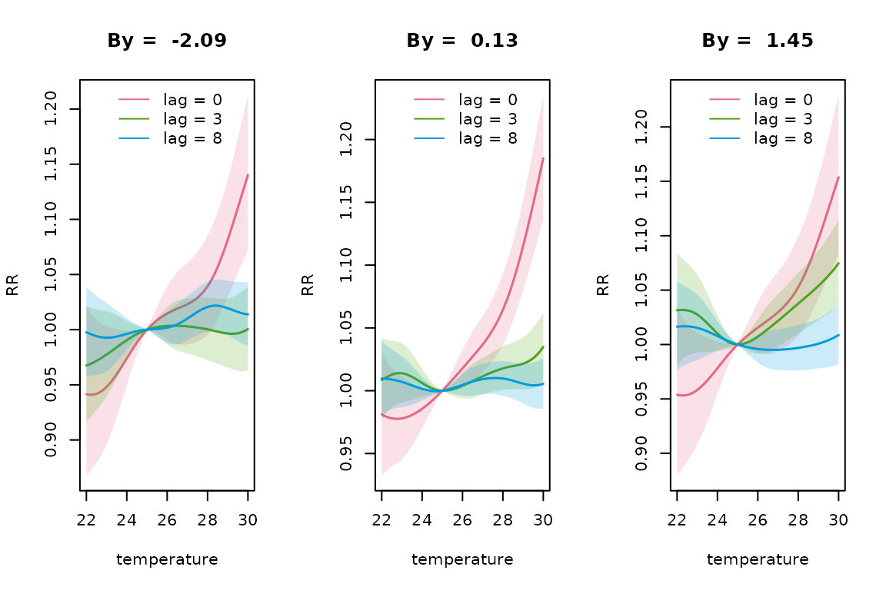
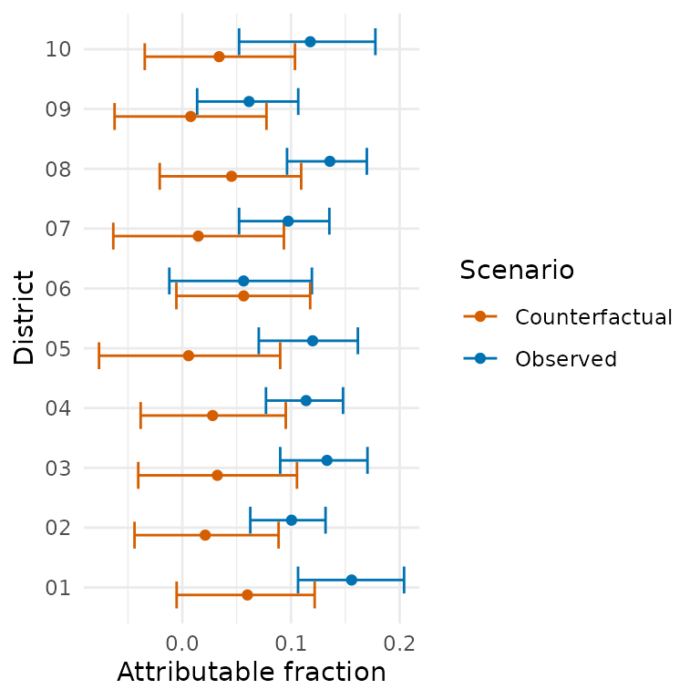

# Effect-modified DLNMs

``` r

library(dlnmLPS)
```

## Introduction

Classical distributed lag non-linear models (DLNMs) assume a common
exposure-lag-response relationships across geographical areas. However,
this relationship might be altered by an effect modifier that differs
between spatial units. For example, the relationship between temperature
and mortality may differ between regions according to the deprivation
index.

`dlnmLPS` provides methods for fitting effect-modified distributed lag
non-linear models, allowing the exposure-lag-response relationship to
vary according to a continuous or categorical covariate (Rutten et al.
2026). This framework allows for flexible interactions between the DLNM
and a possibly non-linear smooth covariate.

In this vignette, we demonstrate how to fit covariate-varying DLNMs
using `dlnmLPS` and show how to predict and visualize the
exposure-lag-response relationship.

The basic functionality of `dlnmLPS`is introduced in
[`vignette("introduction_dlnmlps")`](https://rutten-sara.github.io/dlnmLPS/articles/introduction_dlnmlps.md).

## Effect-modified DLNMs

### Example data

For illustration, we use the following simulated example data:

``` r

# Example data
data(barcelona_temp)
```

This simulated data set contains daily minimum, maximum and mean
temperature in all 10 districts of Barcelona during the summer period (1
June–30 September) between 2007 and 2011. The population size,
deprivation index and daily number of deaths are included for every
district. For this example, we will investigate how the effect of
maximum temperature on mortality spatially varies according to the
deprivation index. The outcome and exposure variable can then be
inspected:

``` r

# Inspect the data
head(barcelona_temp)
#>         date     Tmax     Tmin    Tmean District      pop   depriv dtot
#> 1 2007-06-01 25.85997 17.93684 21.89841       01 659845.8 1.188957   26
#> 2 2007-06-02 25.71266 17.21590 21.46428       01 659845.8 1.188957   27
#> 3 2007-06-03 25.33624 16.95453 21.14538       01 659845.8 1.188957   23
#> 4 2007-06-04 25.47256 15.42090 20.44673       01 659845.8 1.188957   23
#> 5 2007-06-05 23.89031 16.21367 20.05199       01 659845.8 1.188957   26
#> 6 2007-06-06 24.08012 16.47465 20.27739       01 659845.8 1.188957   18
```

We can extract some additional information from the date such as the day
of the week, year and month.

``` r

# Extract date information
dataset <- barcelona_temp |>
  dplyr::mutate(
    dow = weekdays(date),
    year = lubridate::year(date),
    month = lubridate::month(date)
  )
```

### Fitting an effect-modified DLNM

The `dlnmLPS` package provides a lot of flexibility in modelling effect
modification. In this example, we will fit four different models:

- **Categorical effect modification**, a penalized DLNM modified by a
  categorical deprivation index;

- **Linear effect modification**, a penalized DLNM modified by a
  continuous deprivation index, using a linear interaction;

- **Smooth unpenalized effect modification**, a penalized DLNM modified
  by a continuous deprivation index, expressed by natural splines using
  2 knots (on the 10% and 90% percentile);

- **Smooth penalized effect modification**, a penalized DLNM modified by
  a continuous deprivation index, expressed by penalized splines using 5
  df.

We include month as natural splines with 3 degrees of freedom, year as a
random walk of order one, day of the week as a factor and District as an
independent random effect. We use a penalized DLNM with 8 degrees of
freedom and penalty of order 2.

For the first model, we split the deprivation index in a categorical
variable with three levels. We specify the modifying covariate through
the option `by` and include `type`=“factor” in the argument `arg.by`. We
also include the categorical deprivation index as a main effect in the
model. The model can be fitted as:

``` r

# Fit a categorical modified DLNM
group <- factor(paste0(dataset$District, "-", dataset$year))

basis.max_pen <- dlnm::crossbasis(
  dataset$Tmax,
  argvar = list(fun = "ps", df = 8),
  arglag = list(fun = "ps", df = 8),
  lag = 14,
  group = group
)

dataset$depriv_cat <- ifelse(dataset$depriv <= quantile(dataset$depriv,0.25), "low",
                             ifelse(dataset$depriv >= quantile(dataset$depriv,0.75), "high", "medium"))

model1 <- dlnmLPS(dtot ~ factor(dow) + factor(depriv_cat) +
                        sm(basis.max_pen, arg = list(pen = 2),
                           by = depriv_cat, arg.by = list(type = "factor")) +
                        sm(month, arg = list(type = "ns", df = 3)) +
                        sm(year, arg = list(type = "rw1")) +
                        sm(District, arg = list(type = "ind")),
                   data = dataset,
                   offset = log(pop),
                   model.comparison = list(DIC = TRUE, WAIC = TRUE, CPO = TRUE),
                   family = "Poisson")
```

The second model can similarly be fitted by specifying `type`=“linear”
instead of `type`=“factor”. Deprivation index is now also included as a
linear main effect:

``` r

# Fit a linear modified DLNM
model2 <- dlnmLPS(dtot ~ factor(dow) + depriv +
                        sm(basis.max_pen, arg = list(pen = 2),
                           by = depriv, arg.by = list(type = "linear")) +
                        sm(month, arg = list(type = "ns", df = 3)) +
                        sm(year, arg = list(type = "rw1")) +
                        sm(District, arg = list(type = "ind")),
                   data = dataset,
                   offset = log(pop),
                   model.comparison = list(DIC = TRUE, WAIC = TRUE, CPO = TRUE),
                   family = "Poisson")
```

For the third model, we include deprivation index as a smooth effect,
using natural splines with two knots. The model can be fitted as:

``` r

# Fit an unpenalized smooth modified DLNM
knots_depriv <- quantile(dataset$depriv, probs = c(0.10,0.90))

model3 <- dlnmLPS(dtot ~ factor(dow) + sm(depriv, arg = list(type = "ns", knots = knots_depriv)) +
                        sm(basis.max_pen, arg = list(pen = 2),
                           by = depriv, arg.by = list(type = "ns", knots = knots_depriv)) +
                        sm(month, arg = list(type = "ns", df = 3)) +
                        sm(year, arg = list(type = "rw1")) +
                        sm(District, arg = list(type = "ind")),
                   data = dataset,
                   offset = log(pop),
                   model.comparison = list(DIC = TRUE, WAIC = TRUE, CPO = TRUE),
                   family = "Poisson")
```

Lastly, in the fourth model, we include an interaction with deprivation
index using penalized splines:

``` r

# Fit an penalized smooth modified DLNM
model4 <- dlnmLPS(dtot ~ factor(dow) + sm(depriv, arg = list(type = "ps", df = 5, pen = 2)) +
                        sm(basis.max_pen, arg = list(pen = 2),
                           by = depriv, arg.by = list(type = "ps", df = 5, pen = 2)) +
                        sm(month, arg = list(type = "ns", df = 3)) +
                        sm(year, arg = list(type = "rw1")) +
                        sm(District, arg = list(type = "ind")),
                   data = dataset,
                   offset = log(pop),
                   model.comparison = list(DIC = TRUE, WAIC = TRUE, CPO = TRUE),
                   family = "Poisson")
```

We can compare the performance of the four models using model comparison
criteria DIC, WAIC and CPO:

``` r

# Compare the estimated associations
model1$DIC; model1$WAIC; -sum(log(model1$CPO))
#> [1] 30410.81
#> [1] 30414.22
#> [1] 15207.02
model2$DIC; model2$WAIC; -sum(log(model2$CPO))
#> [1] 30390.85
#> [1] 30394.04
#> [1] 15196.9
model3$DIC; model3$WAIC; -sum(log(model3$CPO))
#> [1] 30388.94
#> [1] 30391.41
#> [1] 15195.6
model4$DIC; model4$WAIC; -sum(log(model4$CPO))
#> [1] 30379
#> [1] 30381.98
#> [1] 15190.91
```

The fourth model is preferred based on all model selection criteria.
Using this model, we predict the exposure-lag-response curve for three
different levels of the deprivation index (2.5%, 50% and 97.5%) at
temperatures between 22 and 30 degrees Celsius, relative to a centering
value of 25 degrees. We also request the probability that the logarithm
of the relative risk exceeds 0:

``` r

pred_penalized <- pred_crossbasis(
  basis = basis.max_pen,
  model = model4,
  at_x = seq(22,30,length = 50),
  cen = 25,
  lag = c(0,14),
  CI = TRUE,
  by = round(quantile(dataset$depriv, probs = c(0.025,0.50,0.975)),2),
  exc.prob = TRUE
)
```

Using the
[`extract_predictions()`](https://rutten-sara.github.io/dlnmLPS/reference/extract_predictions.md)
function, we can easily extract (part of) the requested predictions. For
example, if interest is in the lag-specific RR for lag 0 and lag 2 at 22
and 30 degrees and for deprivation quantiles 2.5% and 97.5%, we can use:

``` r

extract_predictions(pred_penalized, slice_x = c(22,30), slice_lag = c(0,2), 
                    slice_by = round(quantile(dataset$depriv, probs = c(0.025,0.975)),2), 
                    ptype = "matRRfit")
#>    x lag       fit     lower    upper   exc.prob    by
#> 1 22   0 0.9415039 0.8677953 1.021473 0.07364462 -2.09
#> 2 30   0 1.1402326 1.0721071 1.212687 0.99998511 -2.09
#> 3 22   2 0.9528834 0.9024280 1.006160 0.04104123 -2.09
#> 4 30   2 1.0198359 0.9848947 1.056017 0.86526035 -2.09
#> 5 22   0 0.9537818 0.8796288 1.034186 0.12591050  1.45
#> 6 30   0 1.1537344 1.0828119 1.229302 0.99999502  1.45
#> 7 22   2 1.0071232 0.9591593 1.057486 0.61221631  1.45
#> 8 30   2 1.0870012 1.0501871 1.125106 0.99999896  1.45
```

To plot the exposure-response relationship at lag 0, 3 and 8 for the
2.5%, 50% and 97.5% percentile deprivation indices, we can use:

``` r

plot(pred_penalized, slice_lag = c(0,3,8), ptype = "slices", CI = TRUE, 
     xlab = "temperature", ylab = "RR")
```



Based on this plot, the differences in temporal evolution of the RR,
based on deprivation index, seem to be small. The plot title indicates
the level of deprivation. The option `multiple.plots` = FALSE allows
visualizing the results for different levels of the deprivation index on
one plot. Note that this option is only available for an integer (and
not a vector) slice value or overall RR-curve. Furthermore, the option
`slice_by` allows to specify only a subset of the predicted `by`-values.
For example, if we only want to plot the 2.5% and 97.5% deprivation
percentiles, we can use:

``` r

plot(pred_penalized, slice_x = 30, 
     slice_by = round(quantile(dataset$depriv,probs = c(0.025,0.975)),2), 
     ptype = "slices", CI = TRUE, xlab = "lag", ylab = "RR", multiple.plots = FALSE)
```


``` r

plot(pred_penalized, slice_by = round(quantile(dataset$depriv, probs = c(0.025,0.975)),2), 
     ptype = "overall", CI = TRUE, xlab = "temperature", ylab = "RR",  
     multiple.plots = FALSE)
```


At high temperatures, there is some evidence that the overall RR is
lower for municipalities with a low deprivation index. A contour plot of
the exposure-lag-response relationship can also be made for different
deprivation levels:

``` r

contour(pred_penalized, ptype = "cross", xlab = "lag", ylab = "temperature")
```


We could also calculate the attributable fraction in 2007 for example.
Using the district-specific maximum temperatures, deprivation index and
deaths, and the backward perspective, we get:

``` r

# Calculate exposure and outcome timeseries
data2007_district <- dataset |>
  dplyr::filter(year == 2007) 

# Calculate attributable risk
af2007_district <- attributable_risk(
  basis = basis.max_pen, 
  cases = data2007_district$dtot, 
  model = model4,
  cen = 25,
  x = data2007_district$Tmax,
  by = data2007_district$depriv,
  group = data2007_district$District,
  dir = "back",
  tot = TRUE,
  samples = TRUE)
```

We could for example also calculate a counterfactual attributable
fraction, in which the deprivation index in every area is equal to the
2.5% deprivation percentile.

``` r

# Calculate counterfactual attributable risk
depriv_lower <- round(quantile(data2007_district$depriv, probs = 0.025, na.rm = TRUE),2)
af2007_counter <- attributable_risk(
  basis = basis.max_pen, 
  cases = data2007_district$dtot, 
  model = model4,
  cen = 25,
  x = data2007_district$Tmax,
  by = rep(depriv_lower, length(data2007_district$depriv)),
  group = data2007_district$District,
  dir = "back",
  tot = TRUE,
  samples = TRUE)
```

Both results could be visualized as:

``` r

# Extract results
af_ci <- dplyr::bind_rows(lapply(seq_along(af2007_district$samples), function(i) {
  x <- af2007_district$samples[[i]]
  data.frame(
    ID = x$ID[1],
    estimate = af2007_district$fit[[i]]$af,
    lower = quantile(x$af, 0.025, na.rm = TRUE),
    upper = quantile(x$af, 0.975, na.rm = TRUE)
  )
}))

counter_ci <- dplyr::bind_rows(lapply(seq_along(af2007_counter$samples), function(i) {
  x <- af2007_counter$samples[[i]]
  data.frame(
    ID = x$ID[1],
    estimate = af2007_counter$fit[[i]]$af,
    lower = quantile(x$af, 0.025, na.rm = TRUE),
    upper = quantile(x$af, 0.975, na.rm = TRUE)
  )
}))

af_plot_df <- dplyr::bind_rows(
  dplyr::mutate(af_ci, scenario = "Observed"),
  dplyr::mutate(counter_ci, scenario = "Counterfactual")
)


# Visualize results
ggplot2::ggplot(af_plot_df, ggplot2::aes(x = estimate, y = ID, colour = scenario)) +
  ggplot2::geom_errorbar(ggplot2::aes(xmin = lower, xmax = upper), orientation = "y", 
                         position = ggplot2::position_dodge(0.5)) +
  ggplot2::geom_point(position = ggplot2::position_dodge(0.5)) +
  ggplot2::scale_colour_manual(values = c("Observed" = "#0072B2","Counterfactual" = "#D55E00")) +
  ggplot2::labs(x = "Attributable fraction", y = "District",colour = "Scenario") +
  ggplot2::theme_minimal()
```



It can be seen that a lower deprivation index, would result in a lower
attributable fraction for some districts.

## Summary

In this vignette, we introduced the effect modifying functionality of
`dlnmLPS`. We demonstrated how to fit four different models, differing
in the flexibility of the effect modification. We used penalized splines
to showcase the functionality of the package but similar models can be
fitted with unpenalized splines. See also
[`vignette("introduction_dlnmlps")`](https://rutten-sara.github.io/dlnmLPS/articles/introduction_dlnmlps.md)
for more information.

## References

Rutten, Sara, Thomas Neyens, Elisa Duarte, Antonio Gasparrini, and
Christel Faes. 2026. “Distributed Lag Non-Linear Models with Spatial
Effect Modification Using Laplacian p-Splines.” *Environmental and
Ecological Statistics*, ahead of print, June.
<https://doi.org/10.1007/s10651-026-00739-0>.
