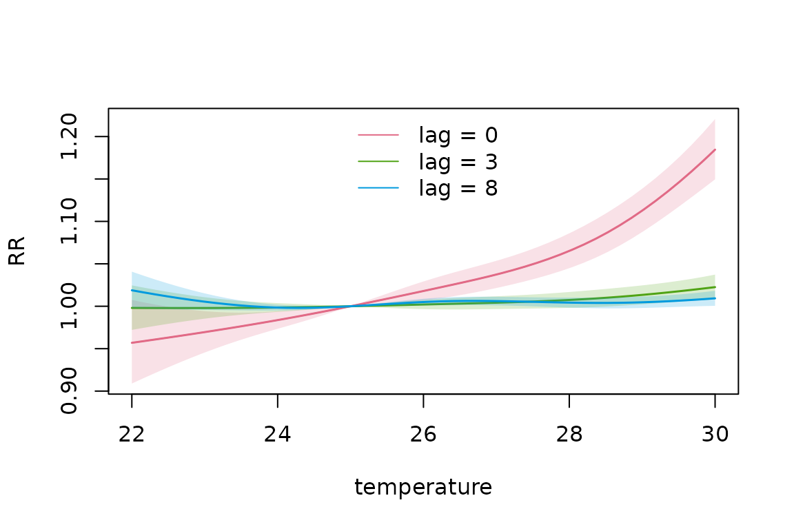
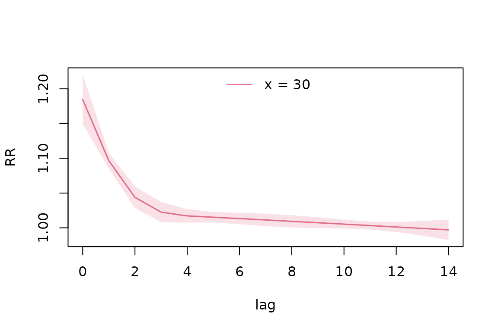
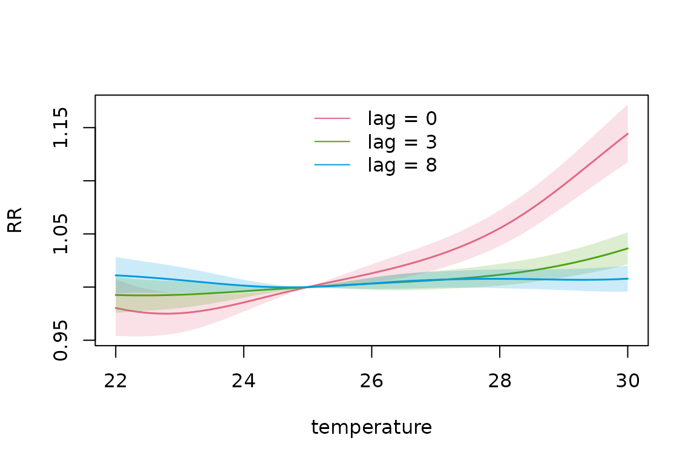
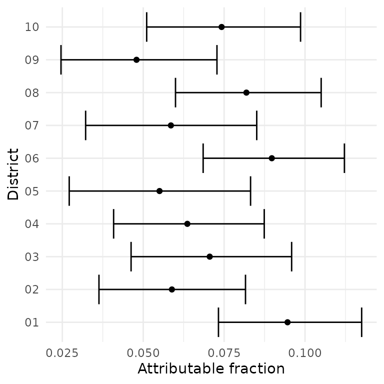
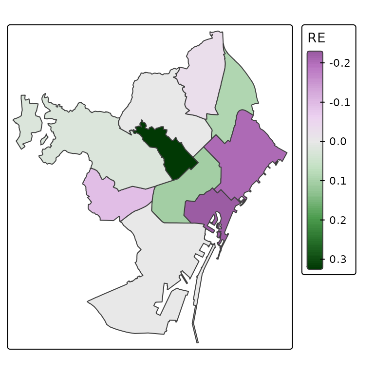
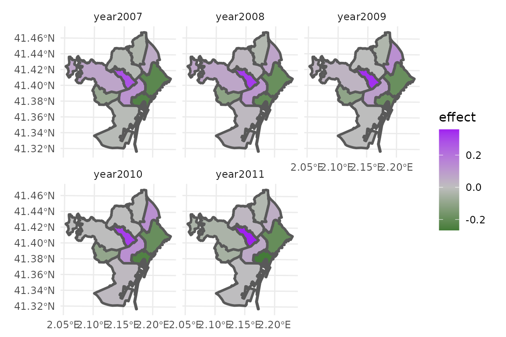

# Introduction to dlnmLPS

``` r

library(dlnmLPS)
```

## Introduction

The `dlnmLPS` package provides tools for fitting Distributed Lag
Non-linear Models (DLNMs) (Gasparrini et al. 2010) within a Bayesian
framework.

DLNMs can require the estimation of a large number of basis coefficients
to represent complex exposure-lag-response relationships. Penalized
DLNMs provide a very flexible way to model these relationships, while
still avoiding overfitting (Gasparrini et al. 2017). However, fitting
penalized DLNMs can be computationally demanding because of the large
number of model coefficients. Consequently, unpenalized DLNMs are often
used in practice.

`dlnmLPS` addresses this computational challenge by exploiting Laplace
approximations, allowing both unpenalized and penalized DLNMs to be
estimated efficiently within a Bayesian framework. This approach allows
for fast estimation while accounting for uncertainty in the model
parameters.

This vignette provides an introduction to the basic functionality of
`dlnmLPS` (Rutten et al. 2026). We first demonstrate how to install and
load the package, then fit a basic DLNM without penalization. We
subsequently show how the same type of model can be fitted using
penalized splines.

The more advanced modelling options are demonstrated in separate
vignettes (see
[`vignette("spatially-varying-dlnms")`](https://rutten-sara.github.io/dlnmLPS/articles/spatially-varying-dlnms.md),
[`vignette("effect-modified-dlnms")`](https://rutten-sara.github.io/dlnmLPS/articles/effect-modified-dlnms.md)
and
[`vignette("joint-dlnms")`](https://rutten-sara.github.io/dlnmLPS/articles/joint-dlnms.md)).

## Installation

The development version of `dlnmLPS` can be installed from GitHub using:

``` r

# install.packages("remotes")
remotes::install_github("Rutten-Sara/dlnmLPS")
```

## Basic DLNMs

### Overview

A distributed lag non-linear model (DLNM) describes an exposure-response
relationship where the exposure can have a delayed effect. The
association can be non-linear in the exposure and lag dimension. The two
dimensions are represented using spline basis functions.

The following example demonstrates how to fit a basic DLNM using
`dlnmLPS`.

### Example data

For illustration, we use the following simulated example data:

``` r

# Example data
data(barcelona_temp)
```

This simulated dataset contains daily minimum, maximum and mean
temperature in all 10 districts of Barcelona during the summer period (1
June–30 September) between 2007 and 2011. The population size,
deprivation index and daily number of deaths are included for every
district. For this example, we will investigate the effect of maximum
temperature on mortality. The outcome and exposure variable can then be
inspected:

``` r

# Inspect the data
head(barcelona_temp)
#>         date     Tmax     Tmin    Tmean District      pop   depriv dtot
#> 1 2007-06-01 25.85997 17.93684 21.89841       01 659845.8 1.188957   26
#> 2 2007-06-02 25.71266 17.21590 21.46428       01 659845.8 1.188957   27
#> 3 2007-06-03 25.33624 16.95453 21.14538       01 659845.8 1.188957   23
#> 4 2007-06-04 25.47256 15.42090 20.44673       01 659845.8 1.188957   23
#> 5 2007-06-05 23.89031 16.21367 20.05199       01 659845.8 1.188957   26
#> 6 2007-06-06 24.08012 16.47465 20.27739       01 659845.8 1.188957   18
```

We can extract some additional information from the date such as the day
of the week, year and month.

``` r

# Extract date information
dataset <- barcelona_temp |>
  dplyr::mutate(
    dow = weekdays(date),
    year = lubridate::year(date),
    month = lubridate::month(date)
  )
```

### Fitting an unpenalized DLNM

We first fit an unpenalized DLNM. The DLNM crossbasis can be constructed
using the `dlnm` package. We use natural splines with three knots in the
exposure dimension (on the 10%, 50% and 90% percentile) and two knots in
the lag dimension, equally spaced on the log scale. We use a maximum lag
of 14 days. Population size is included as an offset.

A crossbasis needs to be supplied within the smooth
[`sm()`](https://rutten-sara.github.io/dlnmLPS/reference/sm.md)
function. Since our response is the number of deaths, we use a Poisson
family. Model comparison criteria DIC, WAIC and CPO can also be
requested.

The model can then be fitted as:

``` r

# Fit an unpenalized DLNM
knots_temp <- quantile(dataset$Tmax, probs = c(0.10,0.50,0.90))
knots_lag <- dlnm::logknots(0:14, nk = 2)
group <- factor(paste0(dataset$District, "-", dataset$year))

basis.max <- dlnm::crossbasis(
  dataset$Tmax,
  argvar = list(fun = "ns", knots = knots_temp),
  arglag = list(fun = "ns", knots = knots_lag),
  lag = 14,
  group = group
)

model_unpenalized <- dlnmLPS(dtot ~ sm(basis.max),
                              data = dataset,
                              offset = log(pop),
                              model.comparison = list(DIC = TRUE, WAIC = TRUE, CPO = TRUE),
                              family = "Poisson")
```

We can include additional covariates in the model. Smooth covariates
need to be supplied within the
[`sm()`](https://rutten-sara.github.io/dlnmLPS/reference/sm.md) function
as well. The argument `arg` can include additional information such as
the `type` of the component (e.g. “ns” for natural splines, “bs” for
B-splines, “ps” for penalized splines) and any additional arguments that
can be passed to the corresponding spline constructor. In this example,
we include month as natural splines with 3 degrees of freedom.

``` r

# Fit an unpenalized DLNM
model_unpenalized2 <- dlnmLPS(dtot ~ factor(dow) + sm(basis.max) +
                                    sm(month, arg = list(type = "ns", df = 3)),
                              data = dataset,
                              offset = log(pop),
                              model.comparison = list(DIC = TRUE, WAIC = TRUE, CPO = TRUE),
                              family = "Poisson")
```

Note that `type` argument of a DLNM-crossbasis is recognized
automatically and hence, does not need to be supplied. The model output
can be inspected using:

``` r

summary(model_unpenalized2)
#> 
#> Call:
#> 
#> dtot ~ 1 + sm(basis.max) + sm(month, arg = list(type = "ns", df = 3)) + factor(dow)
#> 
#> Fixed effects:
#> 
#>                        mean    sd 0.025quant 0.5quant 0.975quant   mode
#> (Intercept)          -9.870 0.130    -10.125   -9.870     -9.615 -9.870
#> basis.maxv1.l1        0.001 0.040     -0.078    0.001      0.080  0.001
#> basis.maxv1.l2       -0.052 0.039     -0.128   -0.052      0.024 -0.052
#> basis.maxv1.l3        0.047 0.040     -0.031    0.047      0.125  0.047
#> basis.maxv1.l4       -0.098 0.038     -0.172   -0.098     -0.023 -0.098
#> basis.maxv2.l1        0.005 0.033     -0.059    0.005      0.070  0.005
#> basis.maxv2.l2       -0.077 0.032     -0.140   -0.077     -0.015 -0.077
#> basis.maxv2.l3        0.092 0.033      0.027    0.092      0.158  0.092
#> basis.maxv2.l4       -0.100 0.031     -0.161   -0.100     -0.039 -0.100
#> basis.maxv3.l1        0.029 0.086     -0.139    0.029      0.196  0.029
#> basis.maxv3.l2       -0.229 0.085     -0.396   -0.229     -0.063 -0.229
#> basis.maxv3.l3        0.257 0.086      0.088    0.257      0.426  0.257
#> basis.maxv3.l4       -0.240 0.083     -0.402   -0.240     -0.078 -0.240
#> basis.maxv4.l1        0.003 0.039     -0.072    0.003      0.079  0.003
#> basis.maxv4.l2       -0.131 0.033     -0.195   -0.131     -0.067 -0.131
#> basis.maxv4.l3        0.364 0.040      0.286    0.364      0.442  0.364
#> basis.maxv4.l4       -0.231 0.033     -0.296   -0.231     -0.166 -0.231
#> month1               -0.180 0.013     -0.205   -0.180     -0.154 -0.180
#> month2               -0.186 0.019     -0.223   -0.186     -0.149 -0.186
#> month3               -0.023 0.010     -0.042   -0.023     -0.003 -0.023
#> factor(dow)Monday     0.016 0.012     -0.008    0.016      0.039  0.016
#> factor(dow)Saturday   0.018 0.012     -0.005    0.018      0.042  0.018
#> factor(dow)Sunday     0.020 0.012     -0.004    0.020      0.043  0.020
#> factor(dow)Thursday   0.002 0.012     -0.021    0.002      0.026  0.002
#> factor(dow)Tuesday    0.010 0.012     -0.014    0.010      0.033  0.010
#> factor(dow)Wednesday  0.013 0.012     -0.011    0.013      0.036  0.013
#> 
#> Model comparison:
#> 
#> DIC: 32612.12 ; Effective Parameters: 26 
#> WAIC: 32626.32 ; Effective Parameters: 38.93717 
#> sum(log(CPO)): -16313.1
```

The summary shows the function call, estimated coefficients (mean,
standard deviation, 2.5% quantile, median, 97.5% quantile and mode) and
model comparison criteria.

The exposure-lag-response curve can be predicted for different levels of
the exposure variable:

``` r

pred_unpenalized <- pred_crossbasis(
  basis = basis.max,
  model = model_unpenalized2,
  at_x = seq(22,30,length = 50),
  cen = 25,
  lag = c(0,14),
  CI = TRUE,
  exc.prob = TRUE,
  threshold = 0
)
```

In this example, we requested predictions of the relative risk (RR) of
temperature values 22-30, compared to a reference value of 25, over the
entire lag period (0-14). Furthermore, we requested credible intervals.
Exceedance probabilities can be requested through: `exc.prob`= TRUE. The
threshold used to calculate these exceedance probabilities needs to be
supplied through `threshold`, at the scale of the linear predictor. By
default, the threshold is specified to be 0, calculating the probability
that the logarithm of the relative risks exceeds 0:

Although all requested predictions are represented in
`pred_unpenalized`, retrieving specific parts of these predictions might
require some manual searching. To avoid this, the wrapper function can
be used to easily extract (parts of) these predictions in one
user-friendly dataset. For example, if we want to extract the overall RR
predictions for a temperature of 22 and 30 degrees Celsius, we can use
`ptype` = “allRRfit” and:

``` r

extract_predictions(pred_unpenalized, slice_x = c(22,30), ptype = "allRRfit")
#>       x      fit     lower    upper  exc.prob
#> [1,] 22 1.134023 0.9654428 1.332041 0.9371987
#> [2,] 30 1.500423 1.4332011 1.570798 1.0000000
```

Note that credible intervals and exceedance probabilities are also
printed if present in the predictions. To extract the lag-specific RRs
at lag 0 and lag 8 for these temperatures, we can similarly use `ptype`
= “matRRfit”:

``` r

extract_predictions(pred_unpenalized, slice_x = c(22,30), slice_lag = c(0,8), ptype = "matRRfit")
#>    x lag       fit     lower    upper   exc.prob
#> 1 22   0 0.9569183 0.9089288 1.007442 0.04671869
#> 2 30   0 1.1845835 1.1495812 1.220652 1.00000000
#> 3 22   8 1.0188142 0.9973264 1.040765 0.95671804
#> 4 30   8 1.0093272 1.0005293 1.018202 0.98116491
```

The estimated exposure-response association can also be visualized at
different lags (e.g. 0,3 and 8) using `ptype` = slices and `slice_lag`:

``` r

plot(pred_unpenalized, slice_lag = c(0,3,8), ptype = "slices", CI = TRUE, 
     xlab = "temperature", ylab = "RR")
```



This plot shows that, while there is an increased immediate risk for
high temperature days, this risk is not visible anymore after three
days. Instead of showing the exposure-response curve at different lags,
we can also show the lag-response curve at pre-specified temperature
level(s) using `slice_x`:

``` r

plot(pred_unpenalized, slice_x = 30, ptype = "slices", CI = TRUE, xlab = "lag", ylab = "RR")
```



For a temperature of 30 degrees, we can indeed see an increased risk
that diminishes after three days. We can also visualize the cumulative
temperature-mortality relationship (cumulative over the entire lag
period) by specifying `ptype`= “overall”.

``` r

plot(pred_unpenalized, ptype = "overall", CI = TRUE, xlab = "temperature", ylab = "RR")
```


Again, an increased overall risk can be found for high temperatures.
Finally, we can visualize the entire temperature-lag-mortality
relationship using `ptype`= “cross”. A contour plot can be requested
using:

``` r

contour(pred_unpenalized, ptype = "cross", xlab = "lag", ylab = "temperature")
```


While a simple 3D plot can be requested using:

``` r

plot(pred_unpenalized, ptype = "cross")
```


additional arguments of
[`graphics::persp`](https://rdrr.io/r/graphics/persp.html) can be used
to make the plot more visually appealing:

``` r

plot(pred_unpenalized, ptype = "cross", ticktype="detailed", theta=230,
        xlab = "lag", ylab = "temperature", zlab = "RR",
        ltheta=200,phi=30,lphi=30,
        nticks = 4, shade = 0.75,r=sqrt(3),d=5,cex.axis=0.5, cex.lab=0.5,border=NA)
```


Note that credible intervals cannot be requested for 3D plots or contour
plots.

### Fitting a penalized DLNM

Flexible basis functions can describe more complex exposure-lag-response
relationships, but an overly flexible model can also result in
overfitting. Penalization provides a way to control the smoothness of
the estimated association. In `dlnmLPS`, penalized DLNMs are estimated
using Laplacian P-splines.

A penalized DLNM can be fitted similarly as an unpenalized DLNM, but the
order of the penalty needs to be supplied in the argument `arg` of
[`sm()`](https://rutten-sara.github.io/dlnmLPS/reference/sm.md). Note
that, by default, an additional lag penalty is specified, on top of the
P-splines penalties, to encourage shrinkage towards a null effect at
longer lags. To disable this penalty, specify `add.lagpen`= “FALSE”
within the `arg` argument.

``` r

# Fit a penalized DLNM
basis.max_pen <- dlnm::crossbasis(
  dataset$Tmax,
  argvar = list(fun = "ps", df = 8),
  arglag = list(fun = "ps", df = 8),
  lag = 14,
  group = group
)

model_penalized <- dlnmLPS(dtot ~ factor(dow) + sm(basis.max_pen, arg = list(pen = 2)) +
                                 sm(month, arg = list(type = "ns", df = 3)),
                            data = dataset,
                            offset = log(pop),
                            model.comparison = list(DIC = TRUE, WAIC = TRUE, CPO = TRUE),
                            family = "Poisson")
```

Note that the summary of this model contains additional arguments, which
are the estimated hyperparameters (penalties):

``` r

summary(model_penalized)
#> 
#> Call:
#> 
#> dtot ~ 1 + sm(basis.max_pen, arg = list(pen = 2)) + sm(month, arg = list(type = "ns", df = 3)) + factor(dow)
#> 
#> Fixed effects:
#> 
#>                        mean    sd 0.025quant 0.5quant 0.975quant   mode
#> (Intercept)          -9.869 0.113    -10.091   -9.869     -9.647 -9.869
#> basis.max_penv1.l1   -0.094 0.060     -0.212   -0.094      0.024 -0.094
#> basis.max_penv1.l2   -0.067 0.034     -0.134   -0.067      0.000 -0.067
#> basis.max_penv1.l3   -0.026 0.026     -0.076   -0.026      0.024 -0.026
#> basis.max_penv1.l4   -0.001 0.022     -0.044   -0.001      0.043 -0.001
#> basis.max_penv1.l5    0.006 0.020     -0.033    0.006      0.046  0.006
#> basis.max_penv1.l6    0.009 0.018     -0.025    0.009      0.044  0.009
#> basis.max_penv1.l7    0.004 0.016     -0.027    0.004      0.036  0.004
#> basis.max_penv1.l8    0.000 0.015     -0.029    0.000      0.030  0.000
#> basis.max_penv2.l1   -0.142 0.078     -0.295   -0.142      0.011 -0.142
#> basis.max_penv2.l2   -0.099 0.037     -0.172   -0.099     -0.027 -0.099
#> basis.max_penv2.l3   -0.025 0.023     -0.071   -0.025      0.021 -0.025
#> basis.max_penv2.l4    0.005 0.019     -0.033    0.005      0.042  0.005
#> basis.max_penv2.l5   -0.005 0.017     -0.038   -0.005      0.028 -0.005
#> basis.max_penv2.l6    0.010 0.015     -0.019    0.010      0.039  0.010
#> basis.max_penv2.l7    0.016 0.014     -0.012    0.016      0.044  0.016
#> basis.max_penv2.l8    0.003 0.015     -0.026    0.003      0.033  0.003
#> basis.max_penv3.l1   -0.120 0.082     -0.281   -0.120      0.041 -0.120
#> basis.max_penv3.l2   -0.057 0.034     -0.123   -0.057      0.010 -0.057
#> basis.max_penv3.l3   -0.017 0.020     -0.057   -0.017      0.023 -0.017
#> basis.max_penv3.l4   -0.008 0.017     -0.040   -0.008      0.025 -0.008
#> basis.max_penv3.l5   -0.017 0.015     -0.046   -0.017      0.012 -0.017
#> basis.max_penv3.l6   -0.011 0.013     -0.037   -0.011      0.014 -0.011
#> basis.max_penv3.l7    0.009 0.013     -0.016    0.009      0.035  0.009
#> basis.max_penv3.l8    0.003 0.015     -0.027    0.003      0.032  0.003
#> basis.max_penv4.l1   -0.073 0.083     -0.236   -0.073      0.089 -0.073
#> basis.max_penv4.l2   -0.041 0.034     -0.106   -0.041      0.025 -0.041
#> basis.max_penv4.l3   -0.016 0.020     -0.056   -0.016      0.024 -0.016
#> basis.max_penv4.l4    0.005 0.016     -0.027    0.005      0.037  0.005
#> basis.max_penv4.l5   -0.005 0.014     -0.032   -0.005      0.023 -0.005
#> basis.max_penv4.l6   -0.008 0.013     -0.033   -0.008      0.016 -0.008
#> basis.max_penv4.l7   -0.009 0.012     -0.033   -0.009      0.015 -0.009
#> basis.max_penv4.l8   -0.004 0.015     -0.033   -0.004      0.026 -0.004
#> basis.max_penv5.l1    0.008 0.082     -0.153    0.008      0.170  0.008
#> basis.max_penv5.l2   -0.007 0.034     -0.073   -0.007      0.060 -0.007
#> basis.max_penv5.l3   -0.008 0.020     -0.048   -0.008      0.032 -0.008
#> basis.max_penv5.l4   -0.011 0.017     -0.044   -0.011      0.021 -0.011
#> basis.max_penv5.l5    0.004 0.015     -0.024    0.004      0.032  0.004
#> basis.max_penv5.l6   -0.007 0.013     -0.032   -0.007      0.019 -0.007
#> basis.max_penv5.l7   -0.015 0.013     -0.040   -0.015      0.010 -0.015
#> basis.max_penv5.l8   -0.002 0.015     -0.031   -0.002      0.028 -0.002
#> basis.max_penv6.l1    0.141 0.081     -0.018    0.141      0.299  0.141
#> basis.max_penv6.l2    0.089 0.036      0.018    0.089      0.160  0.089
#> basis.max_penv6.l3    0.010 0.023     -0.035    0.010      0.055  0.010
#> basis.max_penv6.l4   -0.022 0.019     -0.059   -0.022      0.014 -0.022
#> basis.max_penv6.l5    0.000 0.016     -0.032    0.000      0.032  0.000
#> basis.max_penv6.l6    0.003 0.014     -0.026    0.003      0.031  0.003
#> basis.max_penv6.l7   -0.006 0.014     -0.033   -0.006      0.021 -0.006
#> basis.max_penv6.l8   -0.001 0.015     -0.030   -0.001      0.028 -0.001
#> basis.max_penv7.l1    0.235 0.087      0.065    0.235      0.405  0.235
#> basis.max_penv7.l2    0.139 0.039      0.063    0.139      0.215  0.139
#> basis.max_penv7.l3    0.053 0.026      0.003    0.053      0.104  0.053
#> basis.max_penv7.l4    0.019 0.022     -0.024    0.019      0.063  0.019
#> basis.max_penv7.l5    0.011 0.019     -0.027    0.011      0.049  0.011
#> basis.max_penv7.l6    0.004 0.017     -0.030    0.004      0.037  0.004
#> basis.max_penv7.l7    0.000 0.016     -0.031    0.000      0.031  0.000
#> basis.max_penv7.l8    0.000 0.015     -0.030    0.000      0.030  0.000
#> basis.max_penv8.l1    0.297 0.128      0.046    0.297      0.547  0.297
#> basis.max_penv8.l2    0.146 0.062      0.025    0.146      0.268  0.146
#> basis.max_penv8.l3    0.047 0.039     -0.030    0.047      0.123  0.047
#> basis.max_penv8.l4    0.011 0.030     -0.048    0.011      0.070  0.011
#> basis.max_penv8.l5    0.002 0.024     -0.045    0.002      0.050  0.002
#> basis.max_penv8.l6    0.000 0.020     -0.040    0.000      0.040  0.000
#> basis.max_penv8.l7    0.000 0.018     -0.035    0.000      0.035  0.000
#> basis.max_penv8.l8    0.000 0.016     -0.032    0.000      0.032  0.000
#> month1               -0.180 0.013     -0.206   -0.180     -0.154 -0.180
#> month2               -0.187 0.019     -0.225   -0.187     -0.150 -0.187
#> month3               -0.024 0.010     -0.043   -0.024     -0.004 -0.024
#> factor(dow)Monday     0.012 0.012     -0.011    0.012      0.036  0.012
#> factor(dow)Saturday   0.015 0.012     -0.008    0.015      0.039  0.015
#> factor(dow)Sunday     0.016 0.012     -0.008    0.016      0.040  0.016
#> factor(dow)Thursday   0.004 0.012     -0.020    0.004      0.027  0.004
#> factor(dow)Tuesday    0.007 0.012     -0.016    0.007      0.031  0.007
#> factor(dow)Wednesday  0.013 0.012     -0.010    0.013      0.037  0.013
#> 
#> Hyperparameters:
#> 
#> Penalty DLNM basis.max_pen  129.18 92.50 74.44
#> 
#> Model comparison:
#> 
#> DIC: 32605.98 ; Effective Parameters: 25.59731 
#> WAIC: 32618.12 ; Effective Parameters: 37.42713 
#> sum(log(CPO)): -16308.99
```

Predictions can similarly be visualized:

``` r

pred_penalized <- pred_crossbasis(
  basis = basis.max_pen,
  model = model_penalized,
  at_x = seq(22, 30, length = 50),
  cen = 25,
  lag = c(0,14),
  CI = TRUE
)

plot(pred_penalized, slice_lag = c(0,3,8), ptype = "slices", CI = TRUE, xlab = "temperature", ylab = "RR")
```



``` r

plot(pred_penalized, slice_x = 30, ptype = "slices", CI = TRUE, xlab = "lag", ylab = "RR")
```


``` r

plot(pred_penalized, ptype = "overall", CI = TRUE, xlab = "temperature", ylab = "RR")
```


``` r

contour(pred_penalized, ptype = "cross", xlab = "lag", ylab = "temperature")
```


``` r

plot(pred_unpenalized, ptype = "cross", ticktype="detailed",theta=230,
        xlab = "lag", ylab = "temperature", zlab = "RR",
        ltheta=200,phi=30,lphi=30,
        nticks = 4, shade = 0.75,r=sqrt(3),d=5,cex.axis=0.5, cex.lab=0.5,border=NA)
```


One of the advantages of Bayesian modelling is that uncertainty
quantification can easily be obtained. We already illustrated how to
request exceedance probabilities, but also attributable risks can be
calculated within a DLNM framework (Gasparrini and Leone 2014).
Therefore, the `dlnmLPS` package provides the function
[`attributable_risk()`](https://rutten-sara.github.io/dlnmLPS/reference/attributable_risk.md).
For example, if we want to calculate the attributable fraction of
temperature during the summer of 2007, using the average maximum
temperature and total number of cases (over all Districts), we can use:

``` r

# Calculate exposure and outcome timeseries
data2007 <- dataset |>
  dplyr::filter(year == 2007) |>
  dplyr::group_by(date) |>
  dplyr::summarize(
    Tmax = mean(Tmax, na.rm = TRUE),
    dtot = sum(dtot, na.rm = TRUE)
  )|>
  dplyr::arrange(date)

# Calculate attributable risk
af2007 <- attributable_risk(
  basis = basis.max_pen, 
  cases = data2007$dtot, 
  model = model_penalized,
  cen = 25,
  x = data2007$Tmax,
  dir = "back",
  tot = TRUE,
  samples = TRUE,
  exc.threshold = 0)

# Fit and Credible intervals
af2007$fit$af
#> [1] 0.06620537
quantile(af2007$samples$af, probs = c(0.025,0.975))
#>       2.5%      97.5% 
#> 0.04108535 0.08975188

# Exceedance probability
af2007$samples$exc.prob
#> [1] 1
```

Using the backward perspective on attributable fraction
(i.e. `dir = "back"`), we obtain a total (`tot = TRUE`) attributable
fraction of 0.07(0.04,0.09). The probability that this attributable
fraction is strictly positive is requested through `exc.threshold = 0`,
and is equal to 1. We could also request the forward perspective, using:

``` r

af2007_fw <- attributable_risk(
  basis = basis.max_pen, 
  cases = data2007$dtot, 
  model = model_penalized,
  cen = 25,
  x = data2007$Tmax,
  dir = "forw",
  tot = TRUE,
  samples = TRUE,
  exc.threshold = 0)

# Fit and Credible intervals
af2007_fw$fit$af
#> [1] 0.06273868
quantile(af2007_fw$samples$af, probs = c(0.025,0.975))
#>       2.5%      97.5% 
#> 0.03800329 0.08650474

# Exceedance probability
af2007_fw$samples$exc.prob
#> [1] 1
```

Results are very similar. Instead of calculating the total attributable
fraction, using an average temperature timeseries and total cases, we
could also calculate the district-specific attributable fractions, using
the district-specific timeseries and cases. This output grouping
variable can be specified through the argument `group`:

``` r

# Calculate exposure and outcome timeseries
data2007_district <- dataset |>
  dplyr::filter(year == 2007) 

# Calculate attributable risk
af2007_district <- attributable_risk(
  basis = basis.max_pen, 
  cases = data2007_district$dtot, 
  model = model_penalized,
  cen = 25,
  x = data2007_district$Tmax,
  group = data2007_district$District,
  dir = "back",
  tot = TRUE,
  samples = TRUE)
```

These results could then for example be visualized as:

``` r

# Extract results
af_ci <- dplyr::bind_rows(lapply(seq_along(af2007_district$samples), function(i) {
  x <- af2007_district$samples[[i]]
  data.frame(
    ID = x$ID[1],
    estimate = af2007_district$fit[[i]]$af,
    lower = quantile(x$af, 0.025, na.rm = TRUE),
    upper = quantile(x$af, 0.975, na.rm = TRUE)
  )
}))

# Visualize results
ggplot2::ggplot(af_ci, ggplot2::aes(x = estimate, y = ID)) +
  ggplot2::geom_errorbar(ggplot2::aes(xmin = lower, xmax = upper), orientation = "y") +
  ggplot2::geom_point() +
  ggplot2::labs(x = "Attributable fraction", y = "District") +
  ggplot2::theme_minimal()
```



Some small regional differences can be seen, which could be explained by
different district-specific temperature timeseries and cases.

### Comparing penalized and unpenalized models

The unpenalized and penalized models describe the same underlying
exposure-lag association, but the penalized model allows the smoothness
of the estimated association to be controlled through the penalty.

For example, the resulting associations can be compared using model
comparison criteria:

``` r

# Compare the estimated associations
model_unpenalized2$DIC; model_unpenalized2$WAIC; -sum(log(model_unpenalized2$CPO))
#> [1] 32612.12
#> [1] 32626.32
#> [1] 16313.1
model_penalized$DIC; model_penalized$WAIC; -sum(log(model_penalized$CPO))
#> [1] 32605.98
#> [1] 32618.12
#> [1] 16308.99
```

### Spatial and temporal random effects

Through a smooth function
[`sm()`](https://rutten-sara.github.io/dlnmLPS/reference/sm.md), we can
also include spatial and temporal random effects. An area-specific
random effect can be included independently (`type` = “ind”) or
spatially structured (`type` = “Leroux”, `type` = “ICAR” or `type` =
“BYM”). In case of spatially structured random effects, a map with the
spatial structure can be supplied through `map` within the `arg`
argument. A first or second order random walk on time can also be
supplied through `type` = “rw1” or `type` = “rw2”.

A time-varying spatial random effect or spatially-varying time random
effect can also be requested using the arguments `by` and `arg.by`.

A model with a year-specific random walk of order one and a
district-specific Leroux-structured random effect can be fitted as:

``` r

# Fit a penalized DLNM with spatial and temporal RW
data(shapefile_bcn)
model_penalized2 <- dlnmLPS(dtot ~ factor(dow) + sm(basis.max_pen, arg = list(pen = 2)) +
                                  sm(month, arg = list(type = "ns", df = 3)) +
                                  sm(year, arg = list(type = "rw1")) +
                                  sm(District, arg = list(type = "Leroux", map = shapefile_bcn)),
                             data = dataset,
                             offset = log(pop),
                             model.comparison = list(DIC = TRUE, WAIC = TRUE, CPO = TRUE),
                             family = "Poisson")
```

The District-specific random effect can for example be visualized using:

``` r

re_index <- grepl("District", names(model_penalized2$xi_mode))
shapefile_bcn$re <- model_penalized2$xi_mode[re_index]
tmap::tm_shape(shapefile_bcn) +
  tmap::tm_polygons(
    fill = "re",
    fill.scale = tmap::tm_scale_continuous(midpoint = 0),
    fill.legend = tmap::tm_legend(title = "RE")
  )
#> Registered S3 method overwritten by 'stars':
#>   method                  from
#>   st_interpolate_aw.stars sf
```



A model with an independently year-varying Leroux random effect on
District, can for example be fitted as:

``` r

# Fit a penalized DLNM with temporally varying spatial effect
model_penalized3 <- dlnmLPS(dtot ~ factor(dow) + sm(basis.max_pen, arg = list(pen = 2)) +
                                  sm(month, arg = list(type = "ns", df = 3)) +
                                  sm(District, arg = list(type = "Leroux", map = shapefile_bcn),
                                         by = year, arg.by = list(type = "ind")),
                             data = dataset,
                             offset = log(pop),
                             model.comparison = list(DIC = TRUE, WAIC = TRUE, CPO = TRUE),
                             family = "Poisson")
```

This can for example be visualized using:

``` r

coef_names <- names(model_penalized3$xi_mode)
re_index <- grepl("year", coef_names) &  grepl("District", coef_names)
parts <- strsplit(coef_names[re_index], ":")

df_spat <- data.frame(
  year = sapply(parts, `[`, 1),
  District = sub("District", "", sapply(parts, `[`, 2)),
  effect = as.numeric(model_penalized3$xi_mode[re_index])
) 

sf_plot <- merge(shapefile_bcn, df_spat, by = "District")

ggplot2::ggplot(sf_plot) +
  ggplot2::geom_sf(ggplot2::aes(fill = effect), linewidth = 1) +
  ggplot2::facet_wrap(~ year)  +
  ggplot2::scale_fill_gradient2(
    low = "darkgreen",
    mid = "grey",
    high = "purple",
    midpoint = 0
  ) +
  ggplot2::theme_minimal()
```



Little variation in the Leroux random effect over time can be observed.

## Summary

In this vignette, we introduced the basic functionality of `dlnmLPS`.

We demonstrated how to:

1.  install and load the `dlnmLPS` package;
2.  fit a basic unpenalized DLNM;
3.  fit a penalized DLNM using Laplacian P-splines; and
4.  add spatial and temporal random effects.

The next vignettes provide examples of more advanced applications of
`dlnmLPS`, including spatially varying DLNMs (see
[`vignette("spatially-varying-dlnms")`](https://rutten-sara.github.io/dlnmLPS/articles/spatially-varying-dlnms.md)),
effect-modified DLNMs (see
[`vignette("effect-modified-dlnms")`](https://rutten-sara.github.io/dlnmLPS/articles/effect-modified-dlnms.md)),
and DLNMs with bivariate exposures (see
[`vignette("joint-dlnms")`](https://rutten-sara.github.io/dlnmLPS/articles/joint-dlnms.md)).

## References

Gasparrini, A., B. Armstrong, and M. G. Kenward. 2010. “Distributed Lag
Non-Linear Models.” *Statistics in Medicine* 29 (21): 2224–34.
<https://doi.org/10.1002/sim.3940>.

Gasparrini, A., and M. Leone. 2014. “Attributable Risk from Distributed
Lag Models.” *BMC Medical Research Methodology* 14: 55.
<https://doi.org/10.1186/1471-2288-14-55>.

Gasparrini, Antonio, Fabian Scheipl, Ben Armstrong, and Michael G.
Kenward. 2017. “A Penalized Framework for Distributed Lag Non-Linear
Models.” *Biometrics* 73 (3): 938–48.
<https://doi.org/10.1111/biom.12645>.

Rutten, Sara, Bryan Sumalinab, Oswaldo Gressani, et al. 2026. “Penalized
Distributed Lag Non-Linear Models for Small Area Data Using
Laplacian-p-Splines.” *Statistics and Computing* 36 (February): 38.
<https://doi.org/10.1007/s11222-025-10790-9>.
