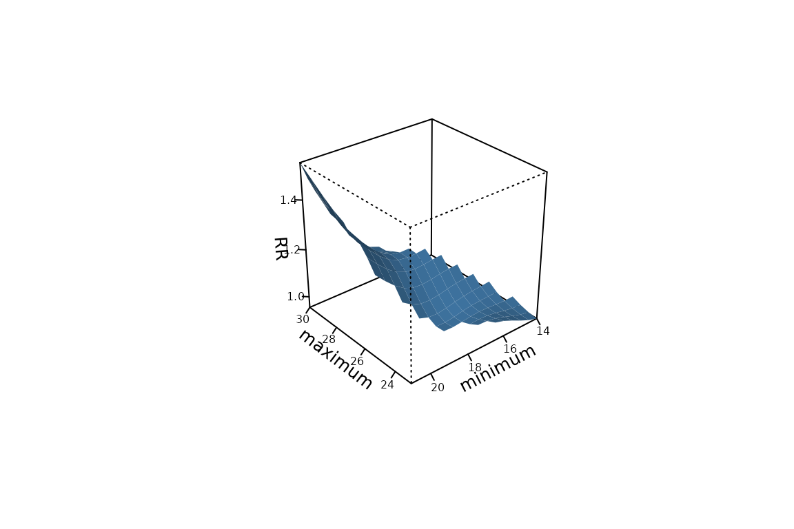
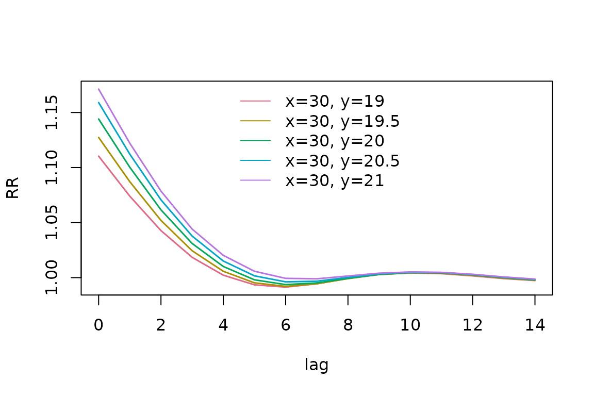
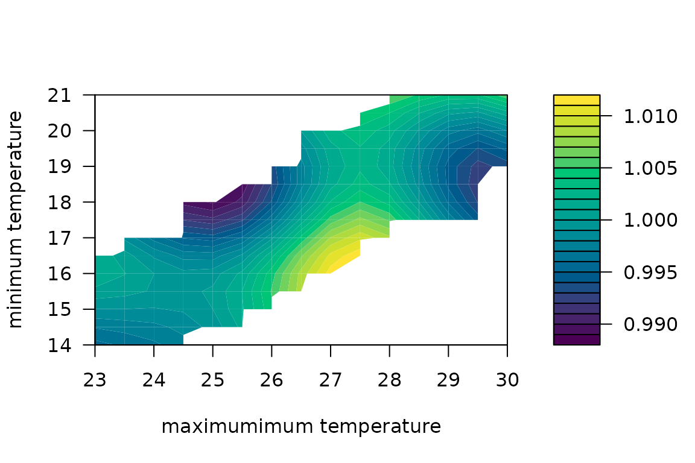
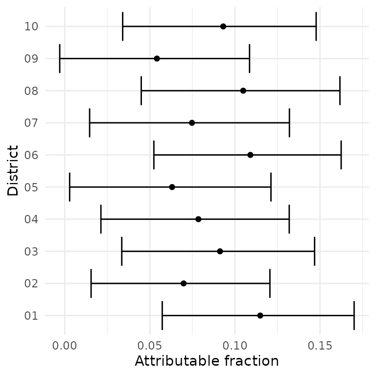

# Bivariate (joint) DLNMs

``` r

library(dlnmLPS)
```

## Introduction

Traditionally, distributed lag non-linear models (DLNMs) are used to
model the effect of one, possibly delayed and non-linear exposure on an
outcome. However, interest might be in the joint effect of two
(bivariate) exposures. For example, the effect of maximum and minimum
temperature on mortality might be synergistic, requiring a joint
modelling strategy.

`dlnmLPS` provides methods for modelling the delayed and non-linear
effect of two exposures jointly (Rutten et al. 2024). In this vignette,
we demonstrate how to fit and visualize these bivariate DLNMs using the
`dlnmLPS` framework.

The basic functionality of `dlnmLPS` is introduced in
[`vignette("introduction_dlnmlps")`](https://rutten-sara.github.io/dlnmLPS/articles/introduction_dlnmlps.md).

## Joint DLNMs

### Example data

For illustration, we use the following simulated example data:

``` r

# Example data
data(barcelona_temp)
```

This simulated dataset contains daily minimum, maximum and mean
temperature in all 10 districts of Barcelona during the summer period (1
June–30 September) between 2007 and 2011. The population size,
deprivation index and daily number of deaths are included for every
district. For this example, we will investigate how maximum and minimum
temperatures jointly impact mortality. The outcome and exposure variable
can then be inspected:

``` r

# Inspect the data
head(barcelona_temp)
#>         date     Tmax     Tmin    Tmean District      pop   depriv dtot
#> 1 2007-06-01 25.85997 17.93684 21.89841       01 659845.8 1.188957   26
#> 2 2007-06-02 25.71266 17.21590 21.46428       01 659845.8 1.188957   27
#> 3 2007-06-03 25.33624 16.95453 21.14538       01 659845.8 1.188957   23
#> 4 2007-06-04 25.47256 15.42090 20.44673       01 659845.8 1.188957   23
#> 5 2007-06-05 23.89031 16.21367 20.05199       01 659845.8 1.188957   26
#> 6 2007-06-06 24.08012 16.47465 20.27739       01 659845.8 1.188957   18
```

We can extract some additional information from the date such as the day
of the week, year and month.

``` r

# Extract date information
dataset <- barcelona_temp |>
  dplyr::mutate(
    dow = weekdays(date),
    year = lubridate::year(date),
    month = lubridate::month(date)
  )
```

### Fitting an additive DLNM

While fitting a joint DLNM requires an extension of the basic
functionality of DLNMs, fitting a model with an additive DLNM of maximum
and minimum temperatures is straightforward.

We include month as natural splines with 3 degrees of freedom, year as a
random walk of order one, day of the week as a factor and District as an
(independent) random effect. Fitting a penalized additive DLNM, using 8
degrees of freedom and a penalty of order 2, can be done as follows:

``` r

# Fit a penalized additive DLNM
group <- factor(paste0(dataset$District, "-", dataset$year))

basis.max_pen <- dlnm::crossbasis(
  dataset$Tmax,
  argvar = list(fun = "ps", df = 8),
  arglag = list(fun = "ps", df = 8),
  lag = 14,
  group = group
)

basis.min_pen <- dlnm::crossbasis(
  dataset$Tmin,
  argvar = list(fun = "ps", df = 8),
  arglag = list(fun = "ps", df = 8),
  lag = 14,
  group = group
)

model_additive <- dlnmLPS(dtot ~ factor(dow) + 
                                sm(basis.max_pen, arg = list(pen = 2)) +
                                sm(basis.min_pen, arg = list(pen = 2)) +
                                sm(month, arg = list(type = "ns", df = 3)) +
                                sm(year, arg = list(type = "rw1")) +
                                sm(District, arg = list(type = "ind")),
                           data = dataset,
                           offset = log(pop),
                           model.comparison = list(DIC = TRUE, WAIC = TRUE, CPO = TRUE),
                           family = "Poisson")
```

### Fitting a joint DLNM

Fitting a joint DLNM is very similar to fitting a traditional DLNM.
However, since the `dlnm` package does not directly provide the
functionality to specify a joint crossbasis, the function
[`joint.crossbasis()`](https://rutten-sara.github.io/dlnmLPS/reference/joint.crossbasis.md)
of the `dlnmLPS` package should be used instead. This function is very
similar to the
[`dlnm::crossbasis()`](https://rdrr.io/pkg/dlnm/man/crossbasis.html)
function, requiring arguments for both exposure variables as well as the
lag. The data can be supplied as a matrix for which the first and second
column contain the timeseries of the first and second exposure
respectively.

Fitting an unpenalized version of the model can be done through:

``` r

# Fit an unpenalized joint DLNM
knots_max <- quantile(dataset$Tmax, probs = c(0.10,0.50,0.90))
knots_min <- quantile(dataset$Tmin, probs = c(0.10,0.50,0.90))
knots_lag <- dlnm::logknots(0:14, nk = 2)

joint.basis <- joint.crossbasis(
                  cbind(dataset$Tmax, dataset$Tmin),
                  argvar1 = list(fun = "ns", knots = knots_max),
                  argvar2 = list(fun = "ns", knots = knots_min),
                  arglag = list(fun = "ns", knots = knots_lag),
                  lag = 14,
                  group = group
                  )

model_unpenalized <- dlnmLPS(dtot ~ factor(dow) + 
                                   sm(joint.basis) +
                                   sm(month, arg = list(type = "ns", df = 3)) +
                                   sm(year, arg = list(type = "rw1")) +
                                   sm(District, arg = list(type = "ind")),
                              data = dataset,
                              offset = log(pop),
                              model.comparison = list(DIC = TRUE, WAIC = TRUE, CPO = TRUE),
                              family = "Poisson")
```

Similarly, a penalized version of the DLNM, using 8 degrees of freedom
and a second order penalty, can be fitted using:

``` r

# Fit a penalized joint DLNM
joint.basis_pen <- joint.crossbasis(
                    cbind(dataset$Tmax, dataset$Tmin),
                    argvar1 = list(fun = "ps", df = 8),
                    argvar2 = list(fun = "ps", df = 8),
                    arglag = list(fun = "ps", df = 8),
                    lag = 14,
                    group = group
                    )

model_penalized <- dlnmLPS(dtot ~ factor(dow) + 
                                 sm(joint.basis_pen, arg = list(pen = 2)) +
                                 sm(month, arg = list(type = "ns", df = 3)) +
                                 sm(year, arg = list(type = "rw1")) +
                                 sm(District, arg = list(type = "ind")),
                              data = dataset,
                              offset = log(pop),
                              model.comparison = list(DIC = TRUE, WAIC = TRUE, CPO = TRUE),
                              family = "Poisson")
```

To visualize this model, we need a grid of realistic maximum and minimum
temperature combinations. A prediction is made for every `at_x`-`at_y`
pair, rather than for cross-pairs. This also implies that the length of
both vectors should be equal. A centering value now consists of a vector
containing the reference value for both the first and the second
exposure. Predictions can then be made and exceedance probabilities can
be requested, using:

``` r

# Realistic maximum - minimum temperature data frame
df = data.frame()
k=1
for (i in seq(23,30,by=0.5)){
  lower_i = min(barcelona_temp$Tmin[barcelona_temp$Tmax<i+0.25 & barcelona_temp$Tmax>i-0.25])
  upper_i = max(barcelona_temp$Tmin[barcelona_temp$Tmax<i+0.25 & barcelona_temp$Tmax>i-0.25])
  for (j in seq(14,21,by=0.5)){
    if (j<upper_i & j>lower_i){
      df[k,1] = i
      df[k,2] = j
      k=k+1
    }
  }
}
colnames(df)=c("x","y")

# Predict RR
pred_penalized <- pred_crossbasis(
  basis = joint.basis_pen,
  model = model_penalized,
  at_x = df$x,
  at_y = df$y,
  cen = c(25,15),
  lag = c(0,14),
  CI = TRUE,
  exc.prob = TRUE
)
```

We can again extract specific predictions of interest using
[`extract_predictions()`](https://rutten-sara.github.io/dlnmLPS/reference/extract_predictions.md).
For example, if we want to extract the lag-specific RRs at the first
three `x` and `y` combinations, we can use:

``` r

extract_predictions(pred_penalized, slice_x = df$x[1:3], slice_y = df$y[1:3], ptype = "allRRfit")
#>       x    y       fit     lower    upper  exc.prob
#> [1,] 23 14.0 0.9535109 0.8644771 1.051715 0.1705951
#> [2,] 23 14.5 0.9647697 0.8742339 1.064682 0.2378110
#> [3,] 23 15.0 0.9815117 0.8827394 1.091336 0.3651059
```

A contour plot and 3D plot of the overall cumulative RR can be made:

``` r

contour(pred_penalized, ptype = "overall", xlab = "maximum temperature", ylab = "minimum temperature")
```


``` r

plot(pred_penalized, ptype = "overall", ticktype="detailed",theta=230,
        xlab = "maximum", ylab = "minimum", zlab = "RR", 
        ltheta=200,phi=30,lphi=30,
        nticks = 4, shade = 0.75,r=sqrt(3),d=5,cex.axis=0.5, cex.lab=0.8,border=NA)
```



The plots seem to suggest that both maximum and minimum temperature are
important when estimating RRs. We can for example also visualize the lag
relationship for specific exposure levels:

``` r

plot(pred_penalized, slice_x = rep(30, sum(pred_penalized$x == 30)), 
     slice_y = pred_penalized$y[pred_penalized$x == 30], ptype = "slices")
```



or the exposures-outcome relationship for the immediate risk (lag = 0):

``` r

contour(pred_penalized, slice_lag = 0, xlab = "maximum temperature", ylab = "minimum temperature", 
        ptype = "slices")
```


and risk after five days:

``` r

contour(pred_penalized, slice_lag = 5, xlab = "maximum temperature", ylab = "minimum temperature",
        ptype = "slices")
```



The attributable fraction in 2007 can also be calculated for example. We
make use of the district-specific maximum and minimum temperature
timeseries and of the backward perspective:

``` r

# Calculate exposure and outcome timeseries
data2007_district <- dataset |>
  dplyr::filter(year == 2007) |>
  dplyr::arrange(District, date)

# Calculate attributable risk
af2007_district <- attributable_risk(
  basis = joint.basis_pen, 
  cases = data2007_district$dtot, 
  model = model_penalized,
  cen = c(25,15),
  x = data2007_district$Tmax,
  y = data2007_district$Tmin,
  group = data2007_district$District,
  dir = "back",
  tot = TRUE,
  samples = TRUE)
```

These results could then be visualized as:

``` r

# Extract results
af_ci <- dplyr::bind_rows(lapply(seq_along(af2007_district$samples), function(i) {
  x <- af2007_district$samples[[i]]
  data.frame(
    ID = x$ID[1],
    estimate = af2007_district$fit[[i]]$af,
    lower = quantile(x$af, 0.025, na.rm = TRUE),
    upper = quantile(x$af, 0.975, na.rm = TRUE)
  )
}))

# Visualize results
ggplot2::ggplot(af_ci, ggplot2::aes(x = estimate, y = ID)) +
  ggplot2::geom_errorbar(ggplot2::aes(xmin = lower, xmax = upper), orientation = "y") +
  ggplot2::geom_point() +
  ggplot2::labs(x = "Attributable fraction", y = "District") +
  ggplot2::theme_minimal()
```



### Fitting a spatial and effect modified joint DLNM

Just as for traditional DLNMs, a joint DLNM can be spatially varying or
subject to effect modification (see
[`vignette("spatially-varying-dlnms")`](https://rutten-sara.github.io/dlnmLPS/articles/spatially-varying-dlnms.md)
and
[`vignette("effect-modified-dlnms")`](https://rutten-sara.github.io/dlnmLPS/articles/effect-modified-dlnms.md)
for more information). The syntax remains exactly the same as for the
univariate DLNM.

## Summary

In this vignette, we introduced the joint modelling functionality of
`dlnmLPS`. We demonstrated how to fit and visualize these models. For
more information, see also
[`vignette("introduction_dlnmlps")`](https://rutten-sara.github.io/dlnmLPS/articles/introduction_dlnmlps.md),
[`vignette("spatially-varying-dlnms")`](https://rutten-sara.github.io/dlnmLPS/articles/spatially-varying-dlnms.md)
and
[`vignette("effect-modified-dlnms")`](https://rutten-sara.github.io/dlnmLPS/articles/effect-modified-dlnms.md).

## References

Rutten, S., E. Duarte, T. Neyens, D. Lauwaet, and C. Faes. 2024. “A
Penalized Distributed-Lag Non-Linear Model for Modeling the Joint
Delayed Effect of Two Predictors: Impact of Minimum and Maximum
Temperature on Mortality.” *medRxiv*, ahead of print.
<https://doi.org/10.1101/2024.11.29.24318041>.
