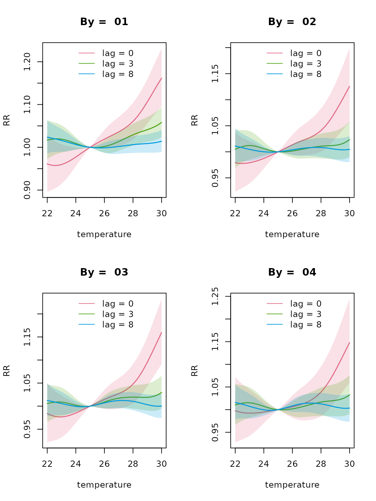
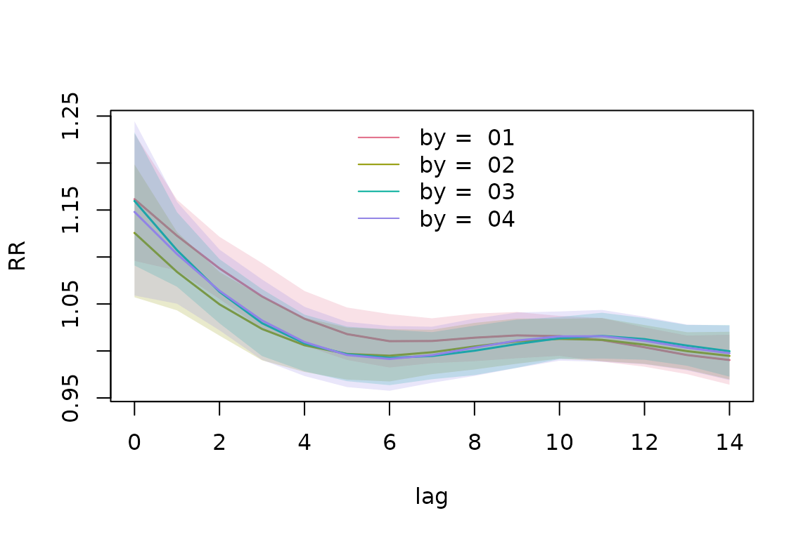
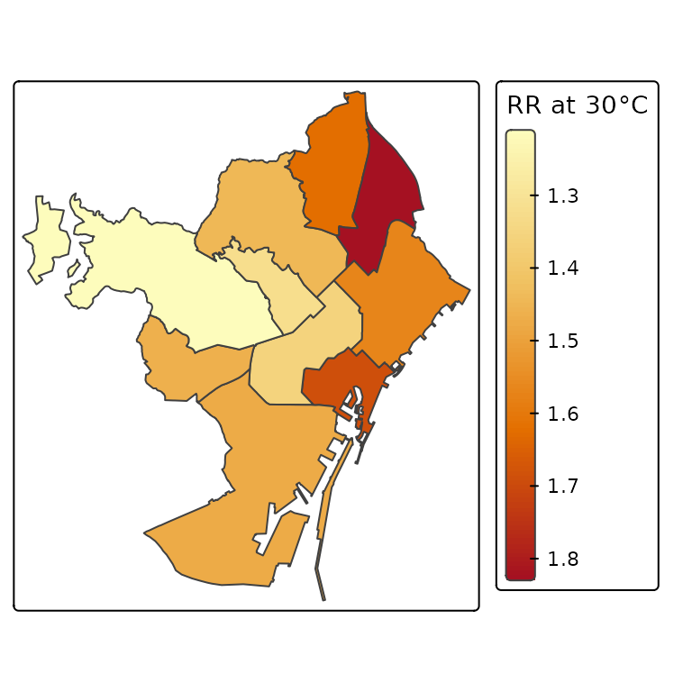
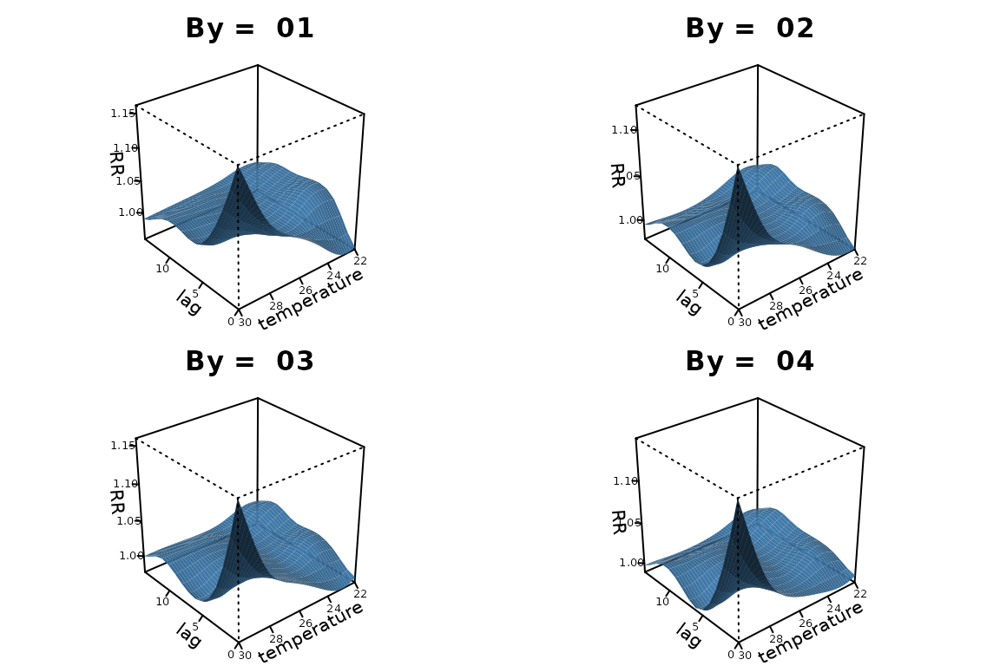
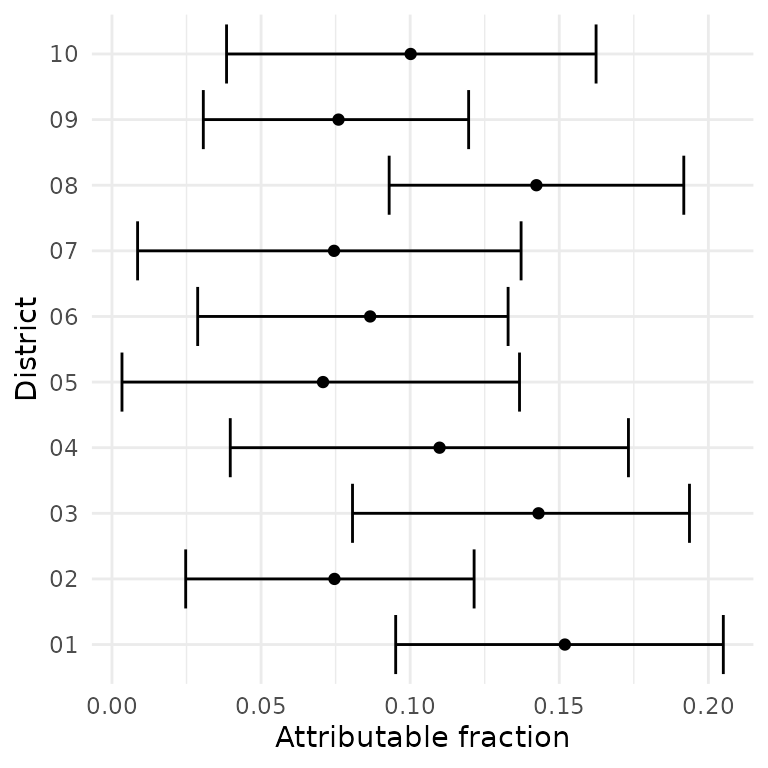

# Spatially varying DLNMs

``` r

library(dlnmLPS)
```

## Introduction

A standard distributed lag non-linear model (DLNM) assumes that the
exposure-lag-response curve is common across all locations. While this
assumption can be useful, it may be too restrictive. In many settings,
the association between exposure and response may vary across space. For
example, the relationship between temperature and mortality may differ
between regions due to differences in population characteristics,
climate, land use or other local factors.

`dlnmLPS` provides methods for fitting spatially varying distributed lag
non-linear models, allowing the exposure-lag-response association to
differ between spatial locations (Rutten et al. 2026). This provides a
flexible framework for investigating both the exposure-response
relationship and geographical variation.

In this vignette, we demonstrate how to fit spatially varying DLNMs
using `dlnmLPS`. We subsequently show how to obtain and visualize the
estimated spatially varying exposure-lag-response curves.

The basic functionality of `dlnmLPS`is introduced in
[`vignette("introduction_dlnmlps")`](https://rutten-sara.github.io/dlnmLPS/articles/introduction_dlnmlps.md).

## Spatially varying DLNMs

### Example data

For illustration, we use the following simulated example data:

``` r

# Example data
data(barcelona_temp)
```

This simulated dataset contains daily minimum, maximum and mean
temperature in all 10 districts of Barcelona during the summer period (1
June–30 September) between 2007 and 2011. The population size,
deprivation index and daily number of deaths are included for every
district. For this example, we will investigate how the effect of
maximum temperature on mortality spatially varies. The outcome and
exposure variable can be inspected:

``` r

# Inspect the data
head(barcelona_temp)
#>         date     Tmax     Tmin    Tmean District      pop   depriv dtot
#> 1 2007-06-01 25.85997 17.93684 21.89841       01 659845.8 1.188957   26
#> 2 2007-06-02 25.71266 17.21590 21.46428       01 659845.8 1.188957   27
#> 3 2007-06-03 25.33624 16.95453 21.14538       01 659845.8 1.188957   23
#> 4 2007-06-04 25.47256 15.42090 20.44673       01 659845.8 1.188957   23
#> 5 2007-06-05 23.89031 16.21367 20.05199       01 659845.8 1.188957   26
#> 6 2007-06-06 24.08012 16.47465 20.27739       01 659845.8 1.188957   18
```

We can extract some additional information from the date such as the day
of the week, year and month.

``` r

# Extract date information
dataset <- barcelona_temp |>
  dplyr::mutate(
    dow = weekdays(date),
    year = lubridate::year(date),
    month = lubridate::month(date)
  )
```

### Fitting a spatially varying DLNM

In this example, we fit four different types of DLNMs, differing in
penalization and spatial structure assumed on the regional curves
(Rutten et al. 2026):

- **Type I**, unpenalized, spatially independent DLNMs;

- **Type II**, penalized, spatially independent DLNMs;

- **Type III**, unpenalized, Leroux-structured DLNMs; and

- **Type IV**, penalized, Leroux-structured DLNMs.

We include month as natural splines with 3 degrees of freedom, year as a
random walk of order one, day of the week as a factor and District as a
random effect.

Fitting all of these models is very similar. First of all, we can fit
models of Type I and Type III, by using an unpenalized crossbasis and
let it vary by District. Spatially-independent DLNMs can be requested
using `fun` = “ind”, while Leroux-varying DLNMs can be specified using
`fun` = “Leroux”. For the latter, a map containing the neighbourhood
structure needs to be provided as well.

``` r

# Fit a spatially varying unpenalized DLNM
data(shapefile_bcn)

knots_temp <- quantile(dataset$Tmax, probs = c(0.10,0.50,0.90))
knots_lag <- dlnm::logknots(0:14, nk = 2)
group <- factor(paste0(dataset$District, "-", dataset$year))

basis.max <- dlnm::crossbasis(
  dataset$Tmax,
  argvar = list(fun = "ns", knots = knots_temp),
  arglag = list(fun = "ns", knots = knots_lag),
  lag = 14,
  group = group
)

model_typeI <- dlnmLPS(dtot ~ factor(dow) + 
                             sm(basis.max,
                                  by = District, arg.by = list(type = "ind")) +
                             sm(month, arg = list(type = "ns", df = 3)) +
                             sm(year, arg = list(type = "rw1")) +
                             sm(District, arg = list(type = "ind")),
                        data = dataset,
                        offset = log(pop),
                        model.comparison = list(DIC = TRUE, WAIC = TRUE, CPO = TRUE),
                        family = "Poisson")

model_typeIII <- dlnmLPS(dtot ~ factor(dow) + 
                               sm(basis.max,
                                  by = District, arg.by = list(type = "Leroux", map = shapefile_bcn)) +
                               sm(month, arg = list(type = "ns", df = 3)) +
                               sm(year, arg = list(type = "rw1")) +
                               sm(District, arg = list(type = "Leroux", map = shapefile_bcn)),
                          data = dataset,
                          offset = log(pop),
                          model.comparison = list(DIC = TRUE, WAIC = TRUE, CPO = TRUE),
                          family = "Poisson")
```

Similarly, models of Type II and Type IV can be fitted using a penalized
DLNM, and providing the order of the penalty in `arg`:

``` r

# Fit a spatially varying penalized DLNM
basis.max_pen <- dlnm::crossbasis(
  dataset$Tmax,
  argvar = list(fun = "ps", df = 8),
  arglag = list(fun = "ps", df = 8),
  lag = 14,
  group = group
)

model_typeII <- dlnmLPS(dtot ~ factor(dow) + 
                              sm(basis.max_pen, arg = list(pen = 2),
                                  by = District, arg.by = list(type = "ind")) +
                              sm(month, arg = list(type = "ns", df = 3)) +
                              sm(year, arg = list(type = "rw1")) +
                              sm(District, arg = list(type = "ind")),
                         data = dataset,
                         offset = log(pop),
                         model.comparison = list(DIC = TRUE, WAIC = TRUE, CPO = TRUE),
                         family = "Poisson")

model_typeIV <- dlnmLPS(dtot ~ factor(dow) + 
                              sm(basis.max_pen, arg = list(pen = 2),
                                  by = District, arg.by = list(type = "Leroux", map = shapefile_bcn)) +
                              sm(month, arg = list(type = "ns", df = 3)) +
                              sm(year, arg = list(type = "rw1")) +
                              sm(District, arg = list(type = "Leroux", map = shapefile_bcn)),
                         data = dataset,
                         offset = log(pop),
                         model.comparison = list(DIC = TRUE, WAIC = TRUE, CPO = TRUE),
                         family = "Poisson")
```

We can compare the performance of the four models using model comparison
criteria DIC, WAIC and CPO:

``` r

# Compare the estimated associations
model_typeI$DIC; model_typeI$WAIC; -sum(log(model_typeI$CPO))
#> [1] 30385.36
#> [1] 30387.4
#> [1] 15193.58
model_typeII$DIC; model_typeII$WAIC; -sum(log(model_typeII$CPO))
#> [1] 30382.18
#> [1] 30385.72
#> [1] 15192.82
model_typeIII$DIC; model_typeIII$WAIC; -sum(log(model_typeIII$CPO))
#> [1] 30375.75
#> [1] 30377.85
#> [1] 15188.8
model_typeIV$DIC; model_typeIV$WAIC; -sum(log(model_typeIV$CPO))
#> [1] 30366.38
#> [1] 30371.28
#> [1] 15185.51
```

Model Type IV is preferred based on all model selection criteria. To
make predictions for temperatures between 22 degrees Celsius and 30
degrees Celsius, compared to a reference level of 25 degrees, and for
all districts, we use:

``` r

pred_penalized <- pred_crossbasis(
  basis = basis.max_pen,
  model = model_typeIV,
  at_x = seq(22,30,length = 50),
  cen = 25,
  lag = c(0,14),
  CI = TRUE,
  by = unique(dataset$District),
  exc.prob = TRUE
)
```

Note that we also requested the region-specific exceedance
probabilities. To extract specific predictions of interest, we can use
the wrapper function
[`extract_predictions()`](https://rutten-sara.github.io/dlnmLPS/reference/extract_predictions.md).
For example, if we want to extract the overall RRs at 30 degrees and for
the first four districts, we can use:

``` r

extract_predictions(pred_penalized, slice_x = 30, slice_by = unique(dataset$District)[1:4],
                    ptype = "allRRfit")
#>    x      fit    lower    upper by
#> 1 30 1.692175 1.504847 1.902821 01
#> 2 30 1.360412 1.162266 1.592337 02
#> 3 30 1.472584 1.281134 1.692644 03
#> 4 30 1.461605 1.209825 1.765784 04
```

We can visualize the temperature-mortality relationship for the first
four districts and for lag 0, 3 and 8 as:

``` r

plot(pred_penalized, slice_lag = c(0,3,8), ptype = "slices", CI = TRUE, xlab = "temperature",
     ylab = "RR", slice_by = unique(dataset$District)[1:4])
```



The option `multiple.plots` = FALSE allows visualizing the results for
different districts on one plot. However, this option is only available
for an integer (and not a vector) slice exposure or lag value or overall
RR-curve. The lag-response relationships at 30 degrees, can be
visualized for the four districts using:

``` r

plot(pred_penalized, slice_x = 30, ptype = "slices", CI = TRUE, xlab = "lag", ylab = "RR",
     multiple.plots = FALSE, slice_by = unique(dataset$District)[1:4])
```



To visualize these lag-response relationships for all districts and
disable the legend and hide the credible intervals, we can specify:

``` r

plot(pred_penalized, slice_x = 30, ptype = "slices", CI = FALSE, xlab = "lag", ylab = "RR",
     multiple.plots = FALSE, show.legend = FALSE)
```


The overall cumulative relationship can be visualized for all districts
using:

``` r

plot(pred_penalized, ptype = "overall", CI = FALSE, xlab = "temperature", ylab = "RR", 
     multiple.plots = FALSE, show.legend = FALSE, col = "black")
```


Moreover, the overall RR for all districts at a temperature value of 30
degrees Celsius could also be presented on a map:

``` r

shapefile_bcn$rr <- sapply(pred_penalized, function(x) x$allRRfit[x$x == 30])
tmap::tm_shape(shapefile_bcn) +
  tmap::tm_polygons(
    fill = "rr",
    fill.scale = tmap::tm_scale_continuous(midpoint = 1,
      values = hcl.colors(7, palette = "RdYlBu", rev = TRUE)),
    fill.legend = tmap::tm_legend(title = "RR at 30°C")
  )
#> Registered S3 method overwritten by 'stars':
#>   method                  from
#>   st_interpolate_aw.stars sf
```



To show the cross exposure-lag-response relationship, a 3D plot can be
made. We adapt the default margins, using the argument `mar`.

``` r

plot(pred_penalized, ptype = "cross", ticktype="detailed",theta=230,
        xlab = "lag", ylab = "temperature", zlab = "RR", mar = c(0.5, 0.5, 2, 0.5),
        ltheta=200,phi=30,lphi=30,
        nticks = 4, shade = 0.75,r=sqrt(3),d=5,cex.axis=0.5, cex.lab=0.8,border=NA,
        slice_by = unique(dataset$District)[1:4])
```



Similarly, a contour plot could also be made. In general, plots show
that differences between the different municipalities in the
temperature-mortality relationship are relatively small.

It’s also possible to calculate the region-specific attributable
fractions for a specific year, for example 2007. For a spatially-varying
DLNM, the output is automatically grouped using the `by` variable, and
hence the `group` argument does not need to be specified. Adopting the
backward perspective, we get:

``` r

# Calculate exposure and outcome timeseries
data2007_district <- dataset |>
  dplyr::filter(year == 2007) |>
  dplyr::arrange(District, date)

# Calculate attributable risk
af2007_district <- attributable_risk(
  basis = basis.max_pen, 
  cases = data2007_district$dtot, 
  model = model_typeIV,
  cen = 25,
  x = data2007_district$Tmax,
  by = data2007_district$District,
  dir = "back",
  tot = TRUE,
  samples = TRUE)
```

The output can be visualized as:

``` r

# Extract results
af_ci <- dplyr::bind_rows(lapply(seq_along(af2007_district$samples), function(i) {
  x <- af2007_district$samples[[i]]
  data.frame(
    ID = x$ID[1],
    estimate = af2007_district$fit[[i]]$af,
    lower = quantile(x$af, 0.025, na.rm = TRUE),
    upper = quantile(x$af, 0.975, na.rm = TRUE)
  )
}))

# Visualize results
ggplot2::ggplot(af_ci, ggplot2::aes(x = estimate, y = ID)) +
  ggplot2::geom_errorbar(ggplot2::aes(xmin = lower, xmax = upper), orientation = "y") +
  ggplot2::geom_point() +
  ggplot2::labs(x = "Attributable fraction", y = "District") +
  ggplot2::theme_minimal()
```



## Summary

In this vignette, we introduced the spatially varying functionality of
`dlnmLPS`. We demonstrated how to fit four different types of
spatially-varying DLNMs, differing in penalization and spatial
structure. See also
[`vignette("introduction_dlnmlps")`](https://rutten-sara.github.io/dlnmLPS/articles/introduction_dlnmlps.md)
for more information.

## References

Rutten, S., T. Neyens, E. Duarte, A. Gasparrini, and C. Faes. 2026.
“Spatially Varying Distributed Lag Non-Linear Models Using Laplacian
P-Splines.” *arXiv Preprint arXiv:2604.09012*, ahead of print.
<https://doi.org/10.48550/arXiv.2604.09012>.
